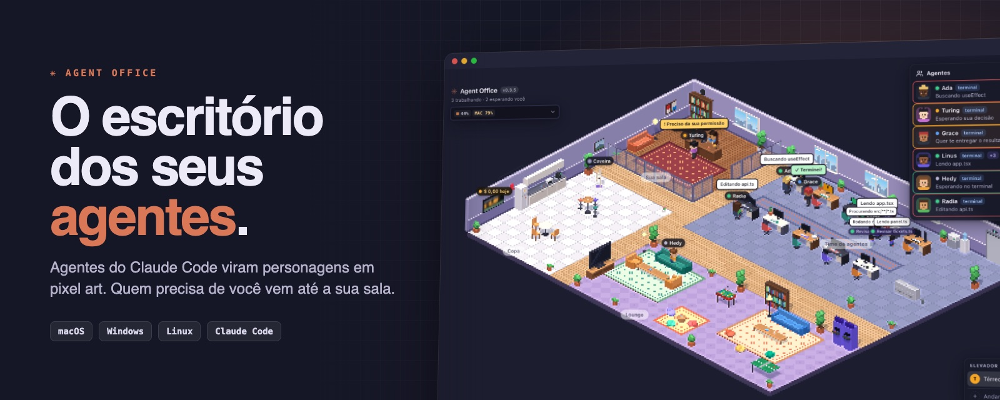
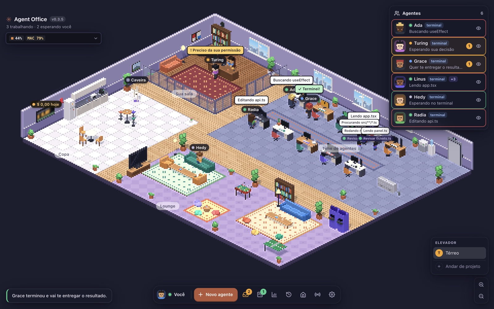
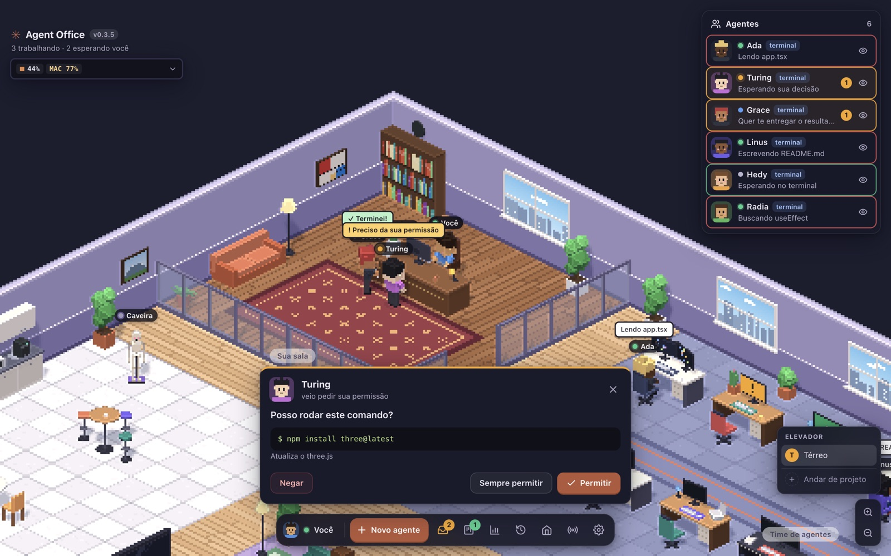
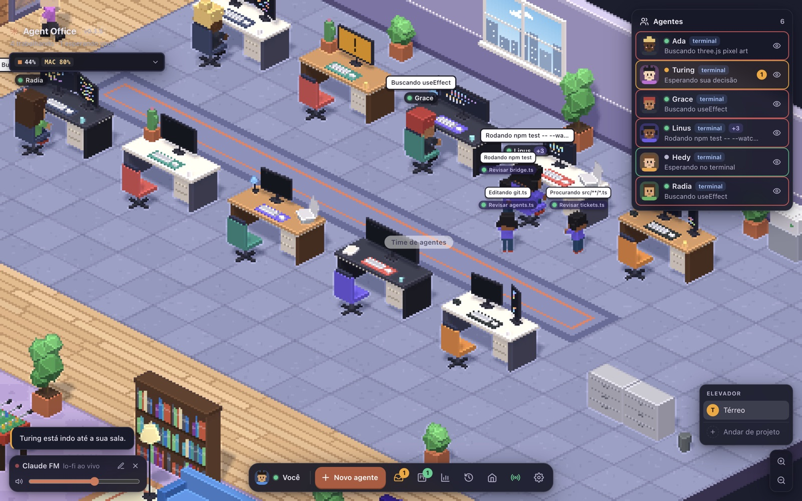
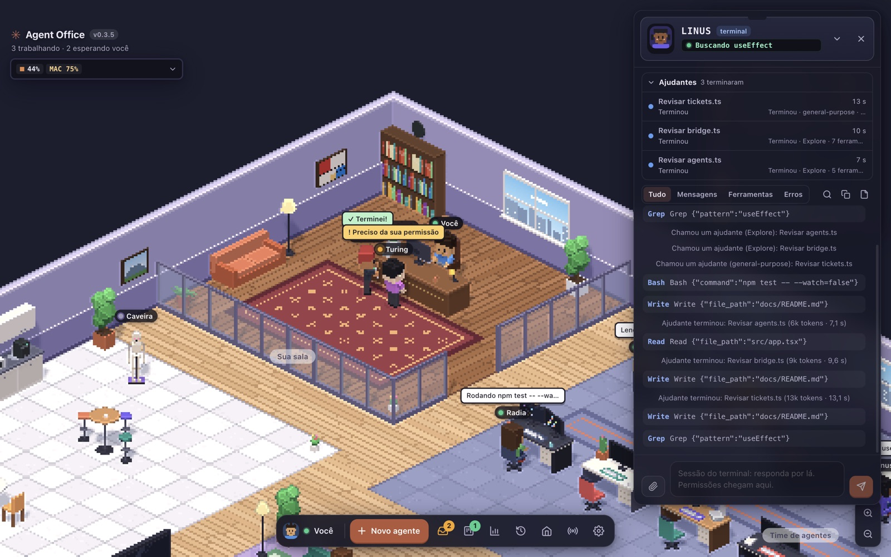
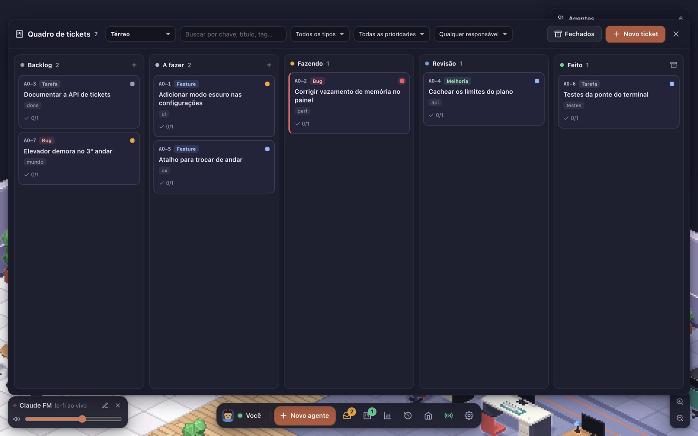
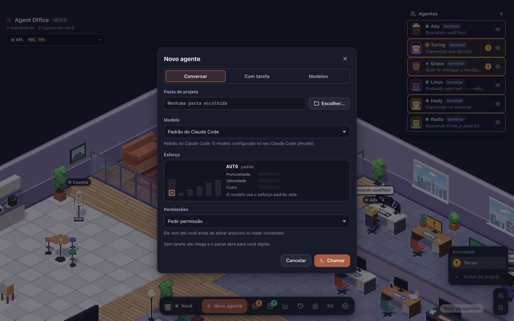
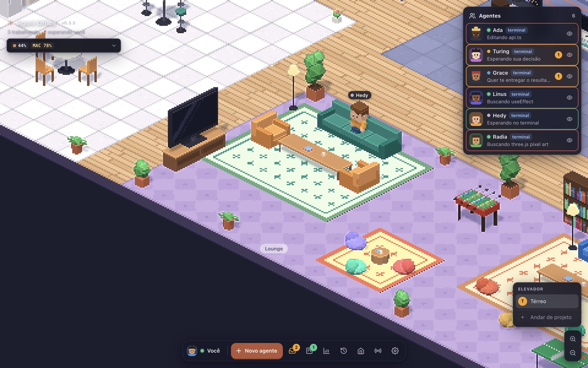

<p align="center">
  
</p>

<p align="center">
  <a href="https://github.com/allefrodrigo/agent-office/releases/latest"></a>
  
  <a href="LICENSE"></a>
</p>

<p align="center"><b>Agentes do Claude Code viram personagens num escritório em pixel art.<br>Você vê quem está trabalhando, quem travou e quem precisa de você, sem vigiar terminal.</b></p>

---

### Nesta edição

| | |
| --- | --- |
| **[A ideia](#a-ideia)** | Por que um escritório |
| **[Um dia no escritório](#um-dia-no-escritório)** | Permissões, painel, quadro, lounge |
| **[Instalar](#instalar)** | macOS, Windows e Linux |
| **[Rodar do código-fonte](#rodar-do-código-fonte)** | Para quem quer mexer |
| **[Releases automáticos](#releases-automáticos)** | Cada versão vira `.dmg`, `.exe` e `.AppImage` |
| **[Por dentro](#por-dentro)** | Arquitetura, segurança e ferramentas |

---

## A ideia

Quem roda vários agentes ao mesmo tempo conhece a rotina: cinco terminais abertos, um deles parado há dez minutos esperando um "sim" que ninguém viu.

O Agent Office troca os terminais por um escritório. Cada agente ganha mesa, computador e avatar. A tela do computador mostra o que ele faz agora. Quando ele precisa de permissão, tem uma pergunta ou termina a tarefa, **levanta e vai até a sua sala**.

> *"Ninguém precisa vigiar terminais. Quem precisa de você vem até você."*

Inspirado no Habbo Hotel (o visual isométrico) e no Gather (o escritório virtual).

<p align="center">
  
  <br><sub><b>O térreo inteiro.</b> No alto, a sua sala. À direita, as mesas do time. Embaixo, o lounge e a copa.</sub>
</p>

---

## Um dia no escritório

### 1. O agente vem pedir permissão



No modo **Pedir permissão**, antes de editar um arquivo ou rodar um comando o agente atravessa o escritório até a sua mesa. O cartão mostra o comando ou o diff, com três saídas: **Permitir**, **Sempre permitir** ou **Negar**. Negar aceita uma instrução do que fazer no lugar.

Perguntas (`AskUserQuestion`) chegam como cartão de opções. Planos (`ExitPlanMode`) chegam para você aprovar ou pedir mudanças.

### 2. O time trabalha, e dá para ver

<table>
<tr>
<td width="55%"></td>
<td>

**Cada balão é uma ferramenta em uso.** "Lendo app.tsx", "Rodando npm test", "Buscando useEffect".

Quando um agente chama subagentes, os ajudantes aparecem do lado da mesa dele, cada um com o próprio balão.

Os diamantes sobre as cabeças mostram em qual conta do Claude cada agente roda.

</td>
</tr>
</table>

### 3. O painel do agente

<table>
<tr>
<td>

**Clique num agente e o log abre ao vivo:** ferramentas, mensagens, erros e os ajudantes que ele chamou.

Mande novas instruções pelo campo de baixo. A sessão continua de onde parou, mesmo depois de reiniciar o app.

O painel também mostra quanto da janela de contexto a conversa ocupa (como o `/context`), com **Compactar** e **Limpar** a um clique.

</td>
<td width="55%"></td>
</tr>
</table>

### 4. Um quadro de tickets que os agentes também usam



Kanban com Backlog, A fazer, Fazendo, Revisão e Feito (tecla `T`). **Delegar** entrega o ticket a um agente: ele recebe contexto e critérios de aceite, trabalha, comenta e move o ticket para Revisão. Os agentes abrem e atualizam tickets sozinhos pelas ferramentas `mcp__office__*`. Só pessoas movem para Feito.

### 5. Contratar é um clique

<table>
<tr>
<td width="55%"></td>
<td>

**Novo agente** (tecla `N`) tem três jeitos de começar:

- **Conversar:** escolha a pasta e fale com ele, como abrir o `claude` no terminal.
- **Com tarefa:** ele sobe pelo elevador, senta numa mesa livre e começa.
- **Modelos:** tarefas prontas que você salvou.

Escolha modelo, esforço e modo de permissão no mesmo lugar.

</td>
</tr>
</table>

### 6. Hora do lounge



Terminou? O agente entrega o relatório e vai relaxar: sofás, pufes, pebolim, fliperama e pingue-pongue. A TV do lounge toca a **Claude FM** (lo-fi ao vivo) ou qualquer playlist do YouTube que você colar.

### E mais

- **Andares por projeto.** Cada andar é uma pasta, com logo, cor e farda da empresa. Agentes pegam o elevador até você.
- **Limites do plano.** Janelas de 5h, da semana e por modelo, como no `/usage`, sem gastar tokens.
- **Várias contas do Claude.** Cada andar escolhe a conta; com duas ou mais, o agente troca de conta quando uma bate o limite.
- **Central de resume.** Traga qualquer sessão antiga de volta como agente, com histórico.
- **Sessões do terminal.** Os `claude` abertos no terminal também aparecem no escritório, e as permissões deles chegam até você.
- **Caveira.** No armário ao lado da sua sala. Encerra a sessão de um agente, com estilo.
- **Tour guiado.** Na primeira abertura, um minuto pelo que fica escondido em teclas e ícones. Reveja com `?`.

<details>
<summary><b>Referência completa de recursos</b></summary>

- **Tour guiado**: na primeira abertura, um tour de um minuto destaca o que fica escondido em teclas e ícones (→ ou Enter avança, ← volta, Esc pula). Reveja pela tecla `?` ou em Configurações → Ajuda → "Rever o tour". Para conferir: `AGENT_OFFICE_TOUR=1 npm run demo` força o tour.
- **Novo agente** (botão principal da barra, tecla `N`, ou a etiqueta "Novo agente" no seu computador): um diálogo com abas que lembra a última usada. Num andar de empresa a pasta é a do andar e não muda; a escolha livre fica no térreo.
  - **Conversar**: escolha só a pasta, sem tarefa. O agente chega e o painel abre para você digitar, como abrir o `claude` no terminal.
  - **Com tarefa**: escolha também nome e tarefa (⌘/Ctrl+Enter contrata). O agente sobe pelo elevador, senta numa mesa livre e já começa.
  - **Squad**: só num andar com squads; contrata o orquestrador com o squad.
- **Andares por projeto** (botão "Andar de projeto" no elevador, ou Configurações → "Andares por projeto"): cada andar é uma pasta de projeto. Quem você contrata ou chama num andar trabalha na pasta dele, sem escolher pasta. Agentes de tickets, da central de resume ou do terminal cuja pasta fica dentro do projeto também sobem para lá. Quando há algo para você, eles pegam o elevador até onde você estiver. Se a pasta tiver squads do Opensquad (`squads/<code>/squad.yaml`), o quadro da Diretoria contrata um orquestrador com o squad inteiro, que roda o pipeline só com a equipe dele; o orquestrador é opcional. Tirar um andar não dispensa ninguém: os agentes descem para o térreo. A pasta de squads das versões anteriores vira o primeiro andar.
- **Andar = empresa** (Configurações → "Andares por projeto"): cada andar aceita um logo (PNG, JPG, WebP ou GIF, reduzido a 256 px) e uma cor; sem cor escolhida, vale a cor mais forte do logo. A placa da Diretoria mostra o logo e o nome, e o tapete dela ganha a cor da empresa. Marque "Agentes com a farda da empresa" para os agentes do andar usarem camisa na cor da empresa com o logo no peito; eles mantêm a farda quando descem até você.
- **Painel de gasto**: cada andar tem um painel na parede com quanto os agentes dele gastaram nesta sessão (no térreo, o escritório inteiro). O valor sobe rolando a cada mudança, os maiores gastos passam embaixo, e a etiqueta acima mostra o valor exato (passe o mouse para ver por agente).
- **Alarme de limite**: quando uma conta bate o limite do plano, o giroflex vermelho acima do painel acende e gira nos andares que usam essa conta (no térreo, com qualquer conta), com a etiqueta "Conta X no limite · volta 15:00".
- **Mesas e áreas**: cada mesa tem um setup (um monitor, dois, ultrawide, notebook com monitor, monitor vertical) em mesas brancas, de madeira ou escuras. O térreo tem uma copa; nos andares de empresa, as salas da frente sem setor viram lounge, copa, jogos e canto de pufes.
- **Conta sobre a cabeça**: cada agente do escritório tem um diamante girando sobre a cabeça, como no The Sims, na cor da conta em que está rodando. Com duas ou mais contas, a etiqueta do nome mostra também o nome da conta.
- **Contexto do agente**: o painel mostra quanto da janela de contexto a conversa ocupa (os mesmos números do `/context`), e a lista de agentes tem uma barrinha. **Compactar** resume a conversa (`/compact`); **Limpar** começa uma conversa nova com o mesmo agente (`/clear`), sem dispensar.
- **Limites do plano**: no canto de cima, as janelas de 5h, da semana e por modelo (ex.: Fable), como no `/usage`, com o horário em que renovam. Atualiza a cada 3 minutos e depois de cada tarefa, sem gastar tokens.
- **Conversa entre sessões**: quando uma sessão do terminal manda mensagem para outra (`SendMessage`), o agente dela anda até a mesa do destinatário e mostra a primeira linha num balão. O nome de cada sessão vem de `~/.claude/sessions/*.json` (formato interno do Claude Code; se mudar, só some a animação).
- **Várias contas do Claude** (Configurações → Contas, ou o ícone de pessoas no card de limites): cada conta extra tem a própria pasta `~/.claude-<nome>`, com login próprio (`CLAUDE_CONFIG_DIR`). Skills, configurações, sessões e memória ficam no `~/.claude` e chegam a ela por links. Cada andar escolhe a conta dos agentes dele; marque duas ou mais para revezar: o agente começa na conta menos usada na janela de 5h e, se ela bater o limite no meio da tarefa, continua a mesma conversa na outra. O card de limites mostra cada conta, e o painel mostra em qual conta o agente está. No terminal, `CLAUDE_CONFIG_DIR=~/.claude-<nome> claude` abre a mesma conta.
- **Sistema**: abaixo dos limites do plano, CPU e RAM do Mac (RAM contada como no Monitor de Atividade), quanto o próprio escritório usa e a soma de todos os processos `claude` (agentes e sessões do terminal). Atualiza a cada 3 segundos.
- **Permissões**: no modo "Pedir permissão", antes de editar arquivos ou rodar comandos o agente vai até você. O cartão mostra o comando ou o diff, com os botões Permitir, Sempre permitir e Negar (negar aceita uma instrução do que fazer em vez disso).
- **Perguntas e planos**: o `AskUserQuestion` vira um cartão com opções; o `ExitPlanMode` mostra o plano para aprovar ou pedir mudanças.
- **Resultados**: ao terminar, o agente leva o relatório até você. Depois de "Recebido", ele vai relaxar no lounge.
- **Quadro de tickets** (botão do quadro ou tecla `T`): kanban com Backlog, A fazer, Fazendo, Revisão e Feito. Cada ticket traz pasta do projeto, contexto, critérios de aceite, tags, pontos e prazo. "Delegar" entrega o ticket a um agente livre ou contrata um novo: ele recebe o ticket completo (o painel mostra "O que o agente lê"), marca os critérios, comenta e, ao terminar, o relatório vira comentário e o ticket vai para Revisão. Você aprova ou pede ajustes. Os agentes do escritório também usam o quadro sozinhos (ferramentas `mcp__office__*`): basta pedir "abra um ticket para isso" ou "liste os tickets em aberto". Só pessoas movem para Feito, e tickets nunca rodam no modo "Sem pedir nada". **Fechar**: os tickets de Feito fecham sozinhos depois de 7 dias (ajuste em "Fechados", ou desligue), ou na hora, pelo ícone de arquivo da coluna Feito ou por "Fechar agora" no ticket. Fechados saem do quadro e vão para `userData/tickets-closed.json`, lido só quando alguém consulta: o botão "Fechados" busca, mostra o contexto e os últimos comentários, e reabre em A fazer. Os agentes só leem fechados quando pedem (`tickets_list` com `closed`, ou `ticket_get` pela chave). O quadro fica em `userData/tickets.json`.
- **Central de resume** (botão do relógio): lista as sessões recentes do Claude Code nesta máquina, do terminal ou do escritório, com busca. "Chamar" traz a sessão de volta como agente, com o histórico e o mesmo modelo; ele espera no lounge até receber a próxima instrução. Também abre a sessão no Terminal (Mac) ou copia o `claude --resume <id>`.
- **Lounge**: agentes livres sentam nos sofás e pufes ou jogam pebolim, fliperama e pingue-pongue.
- **Conversar**: clique no agente para abrir o painel com o log ao vivo e mandar novas instruções. A sessão continua de onde parou, inclusive depois de reiniciar o app.
- **Caveira**: no armário ao lado da sua sala. Clique nela, escolha um agente na lista e confirme. A câmera vai até ele, em qualquer andar, a caveira o derruba e a sessão é encerrada: um agente contratado sai do escritório; o `claude` de um agente do terminal fecha (a conversa fica salva para `claude --resume`).
- **Rotinas** (o totem do lado de fora da sua sala): tarefas que um agente roda sozinho num horário, como "todo dia às 9h, um resumo do repositório". A tela do totem mostra o contador da próxima (ou "!" quando uma espera você), o balão diz qual é ("Relatório diário · em 2h14") e o LED resume tudo: verde tudo certo, amarelo alguma esperando você, vermelho a última execução de alguma falhou, cinza nenhuma rotina. Clique no totem para criar, editar, pausar, rodar agora, duplicar ou apagar, e para ver o histórico das últimas 20 execuções com link para o resultado e para o agente.
  - **Agenda**: uma vez, todo dia, dias da semana, a cada N horas ou minutos (mínimo 15) ou uma expressão cron de 5 campos, sempre no fuso do computador. O formulário mostra a frase ("Roda de segunda a sexta às 09:00") e as próximas 3 execuções; um cron inválido diz o que corrigir.
  - **Quem roda**: um agente novo ou um modelo salvo, contratado na primeira execução e reaproveitado nas seguintes, cada vez com a conversa limpa; ou um agente que já está no escritório, que recebe a tarefa na conversa atual dele. Agente ocupado na hora: a execução é pulada, nunca interrompida. A permissão padrão é "Pedir permissão"; o teto de custo por agente e o revezamento de contas valem como em qualquer tarefa.
  - **Execução**: a tarefa chega com o cabeçalho `Rotina "X" · execução de <data>`, e o resultado vem até a sua sala como qualquer outro. Um pedido de permissão deixa a execução "esperando você". Duas execuções da mesma rotina nunca rodam juntas: se a anterior ainda roda, a nova fica registrada como pulada.
  - **App fechado ou Mac dormindo no horário**: cada rotina escolhe entre rodar uma vez ao abrir (ou ao acordar) e pular, registrando a execução como perdida. Quando uma rotina falha ou fica esperando você, chega uma notificação do sistema.
  - Ficam em `userData/routines.json`, com o mesmo cuidado dos outros arquivos (gravação atômica, arquivo corrompido guardado à parte, backup diário). Rotinas importadas de outra máquina chegam pausadas e nunca no modo "Sem pedir nada".
- **Sessões do terminal**: em Configurações → "Conectar", cada `claude` aberto no terminal também aparece no escritório, e os pedidos de permissão dele chegam até você no app. Se a ponte parar, um ponto âmbar aparece na engrenagem, que abre Configurações direto nessa seção.

Controles: clique no chão para andar, WASD ou setas, arraste com o botão direito para mover a câmera, roda do mouse para zoom. O botão da casinha leva você de volta à sua cadeira. Tecla `?` lista todos os atalhos.

</details>

---

## Instalar

**Antes de tudo: o Claude Code.** O app usa o `claude` instalado na sua máquina, já logado.

```bash
# macOS e Linux
curl -fsSL https://claude.ai/install.sh | bash

# Windows (PowerShell)
irm https://claude.ai/install.ps1 | iex
```

Depois rode `claude` uma vez para fazer login.

Baixe o instalador na **[página de releases](https://github.com/allefrodrigo/agent-office/releases/latest)**.

| Sistema | Arquivo | Como instalar |
| --- | --- | --- |
| **macOS** Apple Silicon | `Agent-Office-<versão>-arm64.dmg` | Abra o `.dmg` e arraste para Aplicativos |
| **macOS** Intel | `Agent-Office-<versão>-x64.dmg` | Igual |
| **Windows** 10/11 | `Agent-Office-Setup-<versão>.exe` | Rode o instalador |
| **Linux** x64 | `Agent-Office-<versão>-x86_64.AppImage` | `chmod +x` e rode |

O app procura versão nova ao abrir e a cada 6 horas. No Windows e no Linux ele se atualiza sozinho; no Mac, só quando o build é assinado com Developer ID. Até lá, baixe o `.dmg` novo e substitua o app.

<details>
<summary><b>macOS: "o app está danificado" ou "não pode ser aberto"</b></summary>

Sem certificado Developer ID, o build é assinado ad-hoc e o Gatekeeper bloqueia a primeira abertura. Abra mesmo assim em **Ajustes do Sistema → Privacidade e Segurança → Abrir Mesmo Assim**, ou rode:

```bash
xattr -dr com.apple.quarantine "/Applications/Agent Office.app"
```

</details>

<details>
<summary><b>Windows: "O Windows protegeu o computador"</b></summary>

O SmartScreen avisa sobre instaladores sem assinatura de código. Clique em **Mais informações → Executar assim mesmo**.

</details>

<details>
<summary><b>Linux: o AppImage não abre</b></summary>

```bash
chmod +x Agent-Office-*.AppImage
./Agent-Office-*.AppImage
```

Se reclamar de FUSE, instale a `libfuse2` (Ubuntu 24.04: `sudo apt install libfuse2t64`; 22.04: `sudo apt install libfuse2`). O Linux é suportado em regime de melhor esforço: o build sai a cada versão, mas é testado menos que Mac e Windows.

</details>

---

## Rodar do código-fonte

Requisitos: **Node 20+**, **git** e o **Claude Code** logado.

<table>
<tr><th>macOS e Linux</th><th>Windows (PowerShell)</th></tr>
<tr>
<td>

```bash
git clone https://github.com/allefrodrigo/agent-office.git
cd agent-office
npm install
npm run dev      # abre o app
npm run demo     # agentes e rotinas simulados, sem gastar tokens
```

</td>
<td>

```powershell
git clone https://github.com/allefrodrigo/agent-office.git
cd agent-office
npm install
npm run dev
$env:AGENT_OFFICE_DEMO=1; npm run dev   # demo
```

</td>
</tr>
</table>

No Linux, o Electron precisa das bibliotecas gráficas de sempre. Num Ubuntu sem desktop: `sudo apt install libgtk-3-0 libnss3 libasound2t64 libgbm1`.

Se aparecer `Error: Electron uninstall`, o binário do Electron não baixou: `node node_modules/electron/install.js`.

Passo a passo de uso e solução de problemas: **[COMO-RODAR.md](COMO-RODAR.md)**.

### Gerar o instalador na sua máquina

```bash
npm run dist:mac     # dist/Agent-Office-<versão>-arm64.dmg e -x64.dmg (+ .zip do auto-update)
npm run dist:win     # no Windows: dist/Agent-Office-Setup-<versão>.exe
npm run dist:linux   # no Linux: dist/Agent-Office-<versão>-x86_64.AppImage
```

O pacote não embute o Claude Code (são ~220 MB). Ele procura o `claude` nesta ordem: variável `AGENT_OFFICE_CLAUDE`, binário do SDK em `node_modules` (só em dev), `PATH` e pastas comuns (`~/.local/bin`, `/opt/homebrew/bin`, ...). Veja `src/main/claude-path.ts`.

---

## Releases automáticos

**Toda versão nova vira release sozinha.** Suba a versão no `package.json`, leve para a `main`, e o GitHub Actions gera e publica o `.dmg` (Apple Silicon e Intel), o `.exe` e o `.AppImage` nas [Releases](https://github.com/allefrodrigo/agent-office/releases/latest).

```bash
npm version patch --no-git-tag-version   # 0.3.5 -> 0.3.6
# abra a PR, aprove e faça o merge: o build começa e espera você aprovar a publicação
```

Como funciona (`.github/workflows/release.yml`):

1. Um push na `main` que muda o `package.json` dispara o workflow. O botão "Run workflow" também.
2. Se a versão já tem release, ele para ali. Pushes sem mudança de versão não geram nada.
3. Builda Mac, Windows e Linux em paralelo, com os `latest*.yml` que o auto-update lê. Os arquivos ficam guardados no próprio run, fora das Releases.
4. Espera a aprovação de quem revisa o ambiente `release` (Actions → o run → **Review deployments**). O ambiente só aceita runs da `main`.
5. Cria e publica a release de uma vez, com os arquivos daquele run. Se o Linux falhar, a release sai com Mac e Windows.
6. Versão com sufixo (`0.4.0-beta.1`) sai como pre-release: só o canal Beta recebe.

O CI (`.github/workflows/ci.yml`) roda `typecheck`, `lint`, `test` e `build` no macOS e no Windows em todo PR e push na `main`.

<details>
<summary><b>Assinatura e notarização (Mac e Windows)</b></summary>

Sem credenciais, `npm run dist:mac` assina ad-hoc (`scripts/dist-mac.mjs`): o app roda na sua máquina, mas o Gatekeeper bloqueia em outras e o auto-update não instala. Para distribuir:

1. Entre no Apple Developer Program e crie um certificado **Developer ID Application**. Exporte como `.p12` com senha.
2. Crie uma senha de app em appleid.apple.com (Login e segurança → Senhas de app) e anote o Team ID (developer.apple.com → Membership).
3. Gere com as credenciais só no ambiente, nunca no repositório:

   ```bash
   export CSC_LINK=~/certs/developer-id.p12      # ou base64 do .p12; ou CSC_NAME="Developer ID Application: Nome (TEAMID)" se já estiver no Keychain
   export CSC_KEY_PASSWORD='senha do .p12'
   export APPLE_ID='voce@exemplo.com'
   export APPLE_APP_SPECIFIC_PASSWORD='abcd-efgh-ijkl-mnop'
   export APPLE_TEAM_ID='ABCDE12345'
   npm run dist:mac
   ```

   Com `CSC_LINK` ou `CSC_NAME`, o build liga o hardened runtime com `resources/entitlements.mac.plist` (só o JIT do V8) e notariza quando as três `APPLE_*` existem.
4. Confira: `spctl --assess --type execute -vv "dist/mac-arm64/Agent Office.app"` deve responder `accepted, source=Notarized Developer ID`.

No CI, as mesmas variáveis vêm dos secrets `MAC_CSC_LINK`, `MAC_CSC_KEY_PASSWORD`, `APPLE_ID`, `APPLE_APP_SPECIFIC_PASSWORD` e `APPLE_TEAM_ID` (veja `.github/workflows/release.yml`).

**Windows:** sem certificado, o SmartScreen avisa "editor desconhecido" nas primeiras instalações. Com um certificado de assinatura de código (OV/EV, ou Azure Trusted Signing), defina `WIN_CSC_LINK` e `WIN_CSC_KEY_PASSWORD` (secrets de mesmo nome no CI).

</details>

<details>
<summary><b>Atualização automática</b></summary>

O app instalado procura versão nova nas Releases do GitHub (`publish` no `electron-builder.yml`) ao abrir e a cada 6 horas, baixa em segundo plano e mostra no alto da tela "Versão X pronta. Reiniciar agora?". Se houver agente trabalhando ou permissão esperando, pergunta antes. Antes de reiniciar grava `office.json` e `tickets.json`. "Depois" instala quando você fechar o app. Em Configurações → Atualizações: canal Estável ou Beta (beta recebe também tags como `v0.4.0-beta.1`) e "Verificar agora". Código em `src/main/updater.ts`.

Requisitos: as Releases precisam ser públicas (repositório público ou um repositório só de releases), e no Mac o app precisa estar assinado com Developer ID. Em dev nada é verificado; `AGENT_OFFICE_FAKE_UPDATE=0.9.0 npm run dev` simula uma versão baixada para testar o aviso e a confirmação (o "Reiniciar" só grava e fecha).

</details>

---

## Por dentro

<details>
<summary><b>Arquitetura</b></summary>

```
src/
  main/                 processo principal (Node)
    agents/             AgentManager: roda agentes com o Claude Agent SDK (query em streaming),
                        traduz mensagens em status/atividade/log (sdk.ts), segura permissões
                        (canUseTool) até você decidir e guarda resultados (decisions.ts), troca
                        de conta no limite (rotation.ts), subagentes (subagents.ts), terminal (index.ts)
    bridge.ts           servidor HTTP local para os hooks do Claude Code (sessões do terminal)
                        e instalador dos hooks em ~/.claude/settings.json
    sessions.ts         central de resume: lista sessões (listSessions do SDK), importa o histórico,
                        abre no Terminal
    peers.ts            acha a sessão pelo nome usado no SendMessage (~/.claude/sessions)
    system.ts           CPU e memória do Mac, do app e dos processos claude
    usage.ts            limites do plano (5h, semana, por modelo) de cada conta, pelo SDK, sem mandar prompt
    accounts.ts         contas do Claude (CLAUDE_CONFIG_DIR + links para ~/.claude), conta de cada execução,
                        revezamento quando uma bate o limite, login pelo Terminal
    claude-path.ts      encontra o executável do Claude Code
    updater.ts          atualização automática pelas Releases do GitHub (electron-updater)
    session-process.ts  descobre o PID do claude de cada sessão do terminal (pela conexão do hook) e o encerra
    squads.ts           squads do Opensquad: lê squad.yaml e o pipeline, monta o orquestrador e fecha a equipe
    store.ts            persistência (userData/office.json)
    routines/           rotinas agendadas: store.ts grava userData/routines.json; scheduler.ts tem um
                        timer para a próxima execução de todas, trata as perdidas ao abrir e ao acordar
                        (powerMonitor 'resume'), entrega a tarefa ao agente e acompanha a execução
                        pelos eventos do AgentManager (resultado, permissão, agente dispensado)
    env.ts              carrega o PATH do shell de login (apps abertos pelo Finder não têm)
    demo.ts             agentes e 3 rotinas simulados (npm run demo); as rotinas demo não são gravadas
    index.ts            janela, notificações, badge do Dock; monta o contexto dos handlers IPC
    ipc/                handlers IPC por área (estado, contas, agentes, worktrees, sessões,
                        configurações, tickets, squads, rotinas); cada argumento passa por validate.ts
    dev-hooks.ts        capturas (AGENT_OFFICE_SHOTS), teclas, bench, seed e falhas forçadas
  preload/index.ts      expõe window.office (API tipada em shared/types/ipc.ts)
  shared/               tipos e textos compartilhados; schedule.ts lê as agendas (presets e cron),
                        calcula a próxima execução e escreve a frase; routines.ts resume o LED e a tela do totem
  renderer/src/
    world/              three.js
      engine.ts         câmera ortográfica 2:1, luz, sombras, RenderPixelatedPass (o visual pixel art)
      layout.ts         planta do térreo (zonas, mesas, lounge) e dos andares de projeto
      office.ts         monta o térreo e a grade de colisão
      upper-floor.ts    monta um andar de projeto: Diretoria, salas do time e setores dos squads
      furniture.ts      móveis em voxel (mesa, monitor, cadeira, plantas, sofá, elevador...)
      avatar.ts         personagens estilo Habbo com animação procedural
      screens.ts        telas dos computadores (canvas pixel art que reflete o status)
      pathfinding.ts    A* em 8 direções com paredes finas
      overlays.ts       crachás com nome e balões de fala (HTML sobre o canvas)
      skull.ts          caveira em voxel (a do armário e a que cai sobre o agente)
      totem.ts          totem das rotinas: tela em canvas redesenhada só quando muda, e o LED
      effects.ts        golpe da caveira, fumaça, faíscas, fantasma e efeitos sonoros
    game/               comportamento: status do agente -> onde ele vai e o que faz
                        (cada parte estende a anterior: base, floors, boards, actors, lounge,
                        deliveries, subagents, squads, skull, movement, input; index.ts monta o Game)
    ui/                 HUD, painel do agente, cartões de permissão/resultado, modais
                        (ui/routines/: a janela do totem e o formulário da rotina)
    styles/             CSS, um arquivo por componente; index.css importa na ordem da cascata,
                        tokens.css tem as cores e fontes
```

Fluxo de um pedido de permissão: o SDK chama `canUseTool` → `AgentManager.requestDecision` emite `permission:new` → o renderer manda o avatar até a sua sala e abre o cartão quando você está perto → `window.office.respond()` resolve a promessa → o agente volta para a mesa.

Sessões do terminal usam o mesmo caminho: o hook `PermissionRequest` (HTTP) fica pendurado até você decidir, com timeout de 10 minutos. Se o app estiver fechado, o hook falha rápido e o Claude Code pergunta no terminal como sempre.

</details>

### Segurança

- O renderer roda com `contextIsolation`, `sandbox` e CSP sem scripts inline; não navega nem abre janelas. Links só abrem se forem `http(s)`.
- A saída dos agentes vira Markdown com HTML escapado e passa pelo DOMPurify.
- A ponte do terminal escuta só em `127.0.0.1`, exige um token aleatório (`userData/bridge-token`, permissão 600) e recusa requisições com `Origin` (vindas de navegador).
- Conectar a ponte faz backup do `~/.claude/settings.json`, preserva seus hooks e nunca sobrescreve um arquivo que não consegue ler. "Desconectar" remove só o que o app adicionou.
- O modo "Sem pedir nada" (`bypassPermissions`) deixa o agente rodar qualquer comando. O app avisa e pede confirmação. Use só em pastas descartáveis.

<details>
<summary><b>Ferramentas de desenvolvimento</b></summary>

Checar tipos: `npm run typecheck`. Lint: `npm run lint`. Testes: `npm test`.

Formatação: o Prettier (`.prettierrc.json`) segue o estilo do código (sem ponto e vírgula, aspas simples), mas o projeto ainda não foi todo formatado. Rode só nos arquivos que você mexeu: `npx prettier --write src/main/updater.ts`.

- `AGENT_OFFICE_SHOTS="out/shot:3000,8000"` salva capturas da janela (escondida) nesses tempos e fecha o app. `AGENT_OFFICE_EVAL="js1|||js2"` roda um trecho antes de cada captura; em dev, `window.__game`, `__state`, `__panel` e `__dialog` ficam disponíveis. Um trecho `keys:N Enter Alt+Right =texto ;; js` aperta teclas de verdade antes (Enter clica o botão em foco, Tab anda; `=texto` digita, `_` é espaço) e depois roda o js: serve para testar o app só pelo teclado. No modo demo, quem você contrata ou chama finge o trabalho (pede para rodar os testes e entrega um resultado) sem abrir o Claude Code.
- `npm run contrast` mostra a razão de contraste dos textos do HUD, lida de `src/renderer/src/styles/`; `npm test` falha se algum par ficar abaixo de AA (4,5:1).
- Tecla `?` no app lista todos os atalhos.
- Log do app em `userData/logs/main-<data>.log` (gira em 5 MB, guarda 5 arquivos; sem prompts nem tokens). `AGENT_OFFICE_DEBUG=1` inclui o nível debug.
- Só em dev: `AGENT_OFFICE_CRASH=main|rejection|renderer|hang|page-error` quebra algo 6 s depois de abrir, para testar o tratamento de erros. `AGENT_OFFICE_LOG_MAX_KB=20` gira o log mais cedo.
- `npm run bench` com `AGENT_OFFICE_DEMO=` (vazio) mede o escritório vazio e parado; `AGENT_OFFICE_BENCH_LIVE=1` mantém o ritmo do loop (passo lento com a cena parada, limite de fps), e o `fps` do relatório vira frames desenhados por segundo. Num headless, `__loop.hidden = true` simula a janela minimizada e `__loop.draws` conta os frames desenhados.
- Só em dev: `AGENT_OFFICE_BATTERY=1` começa como se estivesse na bateria; `=flip` alterna bateria e tomada a cada 5 s, para testar a economia automática sem tirar o cabo.
- `npm run icon` regenera `resources/icon.png` a partir do desenho em `scripts/make-icon.mjs`.

</details>

<details>
<summary><b>Notas do porte para Windows</b></summary>

O código é o mesmo; o que falta validar:

1. `npm install && npm run dev` no Windows. Para o demo no PowerShell: `$env:AGENT_OFFICE_DEMO=1; npm run dev`.
2. `claude-path.ts`: confirmar onde o instalador nativo coloca o `claude.exe` (hoje procura no `PATH`, `%USERPROFILE%\.local\bin`, `%LOCALAPPDATA%\Programs\claude`, `%APPDATA%\npm`).
3. Badge de pendências: `app.setBadgeCount` não funciona no Windows; usar `win.setOverlayIcon` em `index.ts` (`updateBadge`).
4. Barra de título: no Mac usamos `hiddenInset`; no Windows fica a moldura padrão. Avaliar `titleBarOverlay`.
5. `npm run dist:win` gera o instalador NSIS (precisa rodar no Windows).
6. Hooks HTTP são multiplataforma, a ponte do terminal deve funcionar sem mudanças.
7. "Fechar sessão" de um agente do terminal: no Windows o PID vem do `netstat -ano` e a checagem do `tasklist` (`session-process.ts`). Testar, porque o Windows não tem SIGHUP e o `SIGTERM` vira encerramento forçado.

</details>

---

<p align="center"><sub>Feito com Claude Code, por gente que cansou de vigiar terminal. Licença <a href="LICENSE">MIT</a>.</sub></p>
